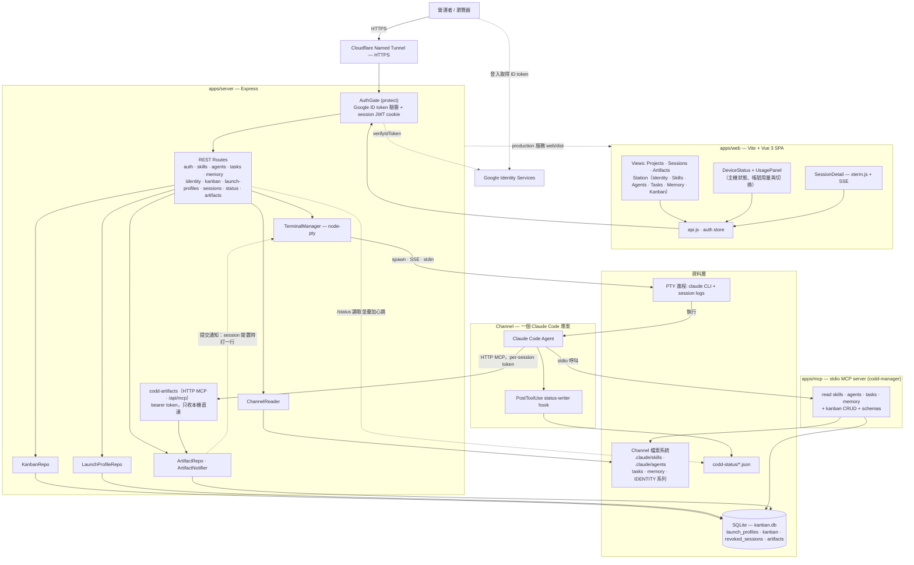
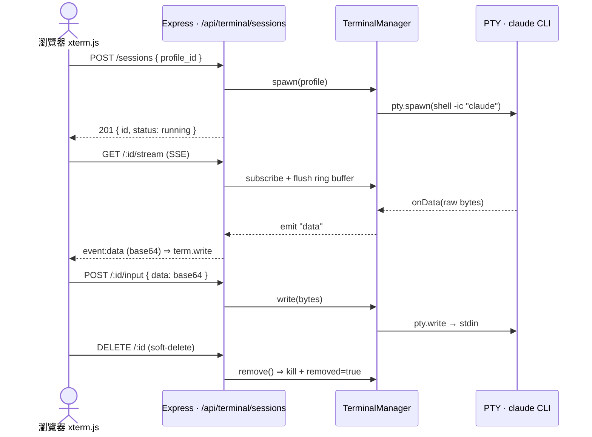

# 🎛️ Fancy CODD — Claude Code Channel Manager

本地端 Express + SQLite + Vite/Vue SPA，**外部用 Cloudflare named tunnel 提供 HTTPS**，**Google Identity Services + ID Token 認證**（無需 client secret），附帶 stdio MCP server 讓 channel 內的 Claude Code agent 自助查詢平台資料。

## 功能

| 模組 | 內容 |
|---|---|
| 🖥️ Sessions | 側欄列出這個 app 開的 Claude Code session（狀態燈、拖曳排序、Alt+1..9），每個 session 可各自設標記色 |
| 📁 Projects | 開 session 的設定（資料夾 + 指令 + env），可設預設標記色，新開的 session 會繼承 |
| 🛰️ Station | 常駐 agent 的基地台：Identity / Skills / Agents / Tasks / Memory / Kanban 合在一頁，用分頁切換 |
| 📊 用量與帳號 | 側欄底部顯示 Claude（cswap）與 Codex 的週用量，可展開看所有帳號並一鍵切換 |
| 🖼️ Artifacts | Claude 透過 CODD 發布的 HTML 頁面與設計畫布，從 `/artifact/<id>` 開，不受 Claude 帳號切換影響；可留言、作答、貼便利貼、標「選這個」，回覆自動存好，回 session 說一聲 Claude 就讀得到；也可以按提交，自動通知原 session |
| 📚 Skills | 列出 `$CHANNEL_PATH/.claude/skills/*/SKILL.md`，可線上編輯 frontmatter + body |
| 🤖 Agents | 列出 `.claude/agents/*.md`，可編輯 |
| ⏰ Tasks | 列出 `tasks/*.md`，可編輯 cron / prompt（不重啟 cron） |
| 🧠 Memory | 唯讀，按日期渲染 markdown |
| 📋 Kanban | Ad-hoc Todo 看板，SQLite 儲存，拖拽切換欄位 |
| 🔌 MCP | stdio MCP server，提供 read + Kanban CRUD tools |

## 架構

npm workspaces monorepo（`apps/server` + `apps/web` + `apps/mcp`），對外只開一個 Cloudflare named tunnel，Google ID Token 認證；附一個 stdio MCP server 讓 channel 內的 Claude Code agent 自助查平台資料，另外 server 本身提供只收本機連線的 HTTP MCP `codd-artifacts`，讓 CODD 開的 session 發布 [artifact](#artifacthtml-頁面與設計畫布)。下圖為整體元件與資料流：



### 目錄結構

```
2026-remote-claude-code-manager/
├── apps/
│   ├── server/   # Express + better-sqlite3 + Google ID Token verify
│   ├── web/      # Vite + Vue 3 SPA
│   └── mcp/      # @modelcontextprotocol/sdk stdio server
├── configs/
│   ├── hooks/ · statusline/ · agents/   # 注入 Claude Code 的 hook、statusline、sub-agent
│   ├── INSTALL.md
│   ├── cloudflared.yml.example
│   ├── cloudflared-service-setup.md
│   ├── cloudflare-access-setup.md
│   └── google-oauth-setup.md
├── scripts/      # setup-cli.js（hooks + statusline）、channel-cli.js（channel 擴充）
├── docs/
│   └── agent-install.md   # 給 Agent 照做的安裝手冊
├── AGENTS.md · CLAUDE.md
├── .env.example
└── README.md
```

### 即時終端機資料流（PTY ↔ SSE ↔ xterm.js）

Sessions 模組把一個 launch profile 在後端 spawn 成 PTY（跑 `claude`），輸出走 SSE 推到瀏覽器的 xterm.js，鍵盤輸入則走 POST 回寫 PTY stdin；DELETE 為 soft-delete（從預設列表移除，filter 可顯示）。



## 讓 Agent 帶你安裝

先在要常駐跑 CODD 的那台 Mac 上，用「終端機」App 做好這幾步（agent 要在 repo 裡才讀得到安裝手冊）：

1. 安裝 Xcode Command Line Tools（含 git）：`xcode-select --install`，在對話框按「安裝」。
2. 安裝 Claude Code：`curl -fsSL https://claude.ai/install.sh | bash`，開一個新的終端機視窗執行一次 `claude` 登入。
3. clone repo（私有 repo 先設好 GitHub 存取權）。不要放在 `~/Documents`、`~/Desktop`、`~/Downloads` 或 iCloud 底下（macOS 隱私權保護，launchd 跑的 server 讀不到）：

   ```bash
   mkdir -p ~/Github && git clone https://github.com/Wcc723/claude-code-operator-dashboard.git ~/Github/fancy-codd && cd ~/Github/fancy-codd
   ```

4. 在這個資料夾執行 `claude`（或 `codex`），貼上這句：

```text
請讀 docs/agent-install.md，帶我安裝 CODD
```

Agent 會先偵測目前裝到哪一步，只在需要你本人時停下來（填 email 與網域、Google OAuth、Cloudflare、各種登入），其餘自己做並逐步驗證。完整流程見 [docs/agent-install.md](docs/agent-install.md)。

## 安裝

需要 Node.js 20+ 與 macOS / Linux。

```bash
# clone 完進到 root
cp .env.example .env && chmod 600 .env
# 編輯 .env、填入 CHANNEL_PATH / GOOGLE_CLIENT_ID / ALLOWED_EMAIL / SESSION_SECRET
# 所有設定（含前端）都只讀這份根目錄 .env，不需要 apps/web/.env

# 安裝
npm install

# 初始化 SQLite
npm --workspace apps/server run migrate
```

### 生 SESSION_SECRET

```bash
node -e "console.log(require('crypto').randomBytes(32).toString('hex'))"
```

### 設 Google OAuth

照 [configs/google-oauth-setup.md](configs/google-oauth-setup.md) 一步一步做。

## 開發

```bash
npm run dev
# Express  → http://localhost:3000
# Vite     → http://localhost:5173  （前端用這個開）
```

Vite proxy 會把 `/api/*` 轉到 Express。

## 上線

```bash
npm run build     # 把 apps/web 編譯到 apps/web/dist
npm start         # .env 的 NODE_ENV=production 時，Express 同時服務 API 跟靜態檔
npm run tunnel    # cloudflared 起 named tunnel（需先按 configs/cloudflared.yml.example 設定）
```

建議用 launchd / systemd / pm2 讓兩個 process 都自動啟動；macOS 的 launchd 範例見 [docs/agent-install.md](docs/agent-install.md) 步驟 6。

## 帳號用量與切換（Claude / Codex）

側欄底部的 USAGE 區顯示目前 Claude 與 Codex 帳號的**週用量**剩餘（Claude 已取消 5 小時用量，所以只列 1w 與各模型的週額度，例如 Fable；細刻度標出「照進度現在應該剩多少」）。點帳號名稱會展開所有帳號的用量，按「切換」→「確定」即可切換。

| Provider | 資料來源 | 切換方式 |
|---|---|---|
| **Claude** | `cswap`（claude-swap）的 `cswap list --json`（server 快取 20 秒） | `cswap switch <編號>`；切換後新開的 session 用新帳號，執行中的建議重開 |
| **Codex** | `codex app-server` 的 `account/rateLimits/read`（目前帳號 60 秒、其他帳號 10 分鐘探測一次） | 本機帳號庫：把每個帳號的 `auth.json` 存在 `~/.fancy-codd/codex-accounts/`（目錄 0700、檔案 0600），切換時先把目前帳號存回帳號庫、備份原檔，再原子替換 `~/.codex/auth.json` |

- 沒裝 `cswap` 時退回 statusline 回報的目前帳號週用量，並提示安裝；沒裝 Codex CLI 時 CODEX 區塊自動隱藏。
- **加入第二個 Codex 帳號**：先在面板按「加入帳號庫」存下目前帳號，再到主機上執行 `codex login`（沒有瀏覽器就用 `codex login --device-auth`）登入另一個帳號，回到面板按 ↻ 後再按「加入帳號庫」。**不要先跑 `codex logout`**：它會到 OpenAI 撤銷目前的登入，帳號庫裡存的那份也會跟著失效。
- 任何 API 回應、log、錯誤訊息都不含 token；畫面預設只顯示 alias 或遮罩過的 email（完整 email 只在滑鼠提示裡）。
- server 可能由 launchd 啟動、PATH 不完整，所以會依序找 `CSWAP_BIN` / `CODEX_BIN` → PATH → `~/.local/bin` → `/opt/homebrew/bin` → `/usr/local/bin`（Codex 另找 Codex.app / ChatGPT.app 內附的 CLI）。其他選填環境變數見 `.env.example`（`CODEX_HOME`、`CODD_CODEX_VAULT`）。

## Artifact（HTML 頁面與設計畫布）

Claude Code 內建的 Artifact 工具發布到 claude.ai，跟著當下登入的 Claude 帳號走；用 `cswap` 切換帳號後，之前發布的頁面常常讀不到。所以 CODD 自己托管 artifact：Claude 在 CODD 開的 session 裡發布，內容存在主機的 SQLite（同一個 `kanban.db`），從 `https://<對外網址>/artifact/<id>` 開，手機或其他電腦都行。跟其他頁面一樣要先登入 CODD（Cloudflare Access + Google 登入）。側欄的 **ARTIFACTS** 列出所有 artifact，可以改名、刪除（soft delete），也能只看某個 session 建立的。

| 種類 | 內容 | 適合 |
|---|---|---|
| **html** | 單一 HTML 頁面 | 報告、互動小工具、表單。頁面可以呼叫 `window.codd.submit(data)`，把任意 JSON（≤ 256 KiB）放進回覆並打開提交視窗 |
| **canvas** | 設計畫布：多個 HTML 設計稿（frame，1–24 個）、問答卡（單選 / 複選 / 填空，最多 30 張）、說明卡（最多 30 張）。可平移縮放 | 比較方案、請你挑一個、收集設計回饋 |

### Claude 怎麼拿到工具

不用另外設定。CODD 開 session 時，只要 project 的指令是互動式 `claude …`（以 `claude` 開頭，沒有 `;`、`&&`、`|`、`<`、`>`、`#`、`$(` 這類 shell 控制字元，結尾也不是 `\`；`-c`、`--resume` 也算），就在指令最後面自動加上：

| 參數 | 內容 |
|---|---|
| `--mcp-config apps/server/data/mcp/<session id>.json` | 掛上 HTTP MCP server `codd-artifacts`（`http://127.0.0.1:<PORT>/api/mcp`），帶這個 session 專屬的 bearer token。token 只存在 server 記憶體與這個 0600 的設定檔，session 結束就撤銷並刪檔，server 重啟後全部失效 |
| `--settings apps/server/data/mcp/codd-artifacts.settings.json` | 內容只有 `permissions.allow: ["mcp__codd-artifacts"]`（不含 token），Claude 呼叫 artifact 工具時不必每次在終端機按同意。profile 指令自己已經有 `--settings` 時不加（避免蓋掉你的設定）；你的 settings 裡的 deny 規則仍然優先 |

- 不想要時：`CODD_ARTIFACTS_MCP=0` 完全不掛（spawn 指令跟沒有這個功能時一樣，已發布的 artifact 仍然看得到）；`CODD_ARTIFACTS_AUTO_ALLOW=0` 照掛，但不帶 `--settings`，工具照 Claude Code 原本的權限設定詢問。改了要重啟 server。
- codex 或其他指令開的 session 不會掛。已經在跑的 session 不會補掛，要重開。
- MCP 的 instructions 會請 Claude 優先用 CODD 的工具，但不封鎖內建的 Artifact 工具。
- 這跟下面「接 MCP 進你的 channel」的 `codd-manager`（stdio）是兩個不同的 MCP server。

| Tool | 用途 |
|---|---|
| `artifact_create` | 發布新的 artifact：`kind: "html"` 給 `html`，`kind: "canvas"` 給 `canvas`。回傳 `{ id, kind, title, version, url }`，Claude 會把 url 給你。頁面已經寫成檔案時可以用 `html_path`（這個 session 工作目錄底下的 `.html` / `.htm`）代替 `html` |
| `artifact_update` | 發布新版本（version +1），或只給 `title` 只改名。只能改這個 session 建立的（restart 後接手的 session 也算）。canvas 沒改的 frame 只給 id 就沿用原本的 HTML。舊版本有 Claude 還沒讀過的回覆時，另外回 `previous_version_draft` 與 `warning`（讀過的不算） |
| `artifact_get` | 讀內容與狀態：指定版本的 HTML 或 canvas、版本列表、提交數、未讀數、這個版本有沒有還沒提交的草稿（`has_draft`）、任何版本有沒有 Claude 還沒讀過的回覆（`draft_unread`、`unread_draft_versions`） |
| `artifact_list` | 列出 artifact（新到舊），含未讀提交數與 `has_unread_draft`；`this_session_only: true` 只列這個 session 建立的 |
| `artifact_read_submissions` | 一次回答「使用者說了什麼」：未讀的提交，加上每個版本 Claude 還沒讀過的未提交回覆（各標版本）。每段一份 Markdown 摘要，最後附 JSON。`id` 可以省略（這個 session 最近有動靜的 artifact，有未讀內容的優先；host token 一定要給）。預設只回未讀的並標成已讀，`mark_read: false` 只看不標，不是這個 session 建立的 artifact 一律只看不標。未提交的回覆只回新的與改過的，最上面寫自從上次讀取改了什麼（例如「新增留言 2、修改 1、刪除 1」），沒有新東西就只回一句「沒有新的回覆」。`full: true` 全部重看，`include_draft: false` 只看提交，`seq` 只讀某一次提交，`draft_version` 只讀某個版本的未提交回覆（這兩個都要跟 `id` 一起給）。JSON 太長時只回摘要，照回應給的參數帶 `draft_stamp` + `offset` 分段，讀到最後一段才標已讀；摘要夠用的話帶 `ack_draft: true` 直接標已讀，不必讀完 JSON |

HTML 必須自成一體：CSS / JS 內嵌或從 https CDN 載入，不能 fetch / XHR / WebSocket 連網，不能引用相對路徑的資源，也不能用 cookie / localStorage。單一 artifact 預設上限 3 MiB（canvas 算整個 spec 的 JSON），單一 frame 的 HTML 上限 1.5 MiB。

### 回饋流程

1. Claude 用 `artifact_create` 發布，把 url 給你。
2. 你在 `/artifact/<id>` 上回覆。回覆是草稿，自動存在 server，換一台裝置打開還在：
   - **留言**：切到「留言」模式，點頁面上任何元素，留言會釘在那裡，並附上被點到的元素（標籤、class、文字、selector、位置）。「清單」列出所有留言。
   - **問答**（canvas）：直接在問答卡上作答。
   - **便利貼**（canvas）：切到「便利貼」模式，點畫布任意處貼一張，可以拖曳、換色。
   - **選這個**（canvas）：在 frame 標題列按 ★「選這個」，標出喜歡的方案。
3. 接下來有兩條路，都可以用：

   **不按提交**：回 session 跟 Claude 說一聲（「看一下」「我回了」「改好了」）就好。回覆停手 0.8 秒就存好，切到別的分頁或 App 時也會立刻存，所以切到終端機開口時內容已經在 server 上。Claude 呼叫 `artifact_read_submissions` 讀目前的內容，連打到一半的留言也讀得到。這條路沒有任何通知：CODD 不會為了草稿往終端機打字，你開口 Claude 才讀。Claude 每次只讀到上次之後新增、改過、刪掉的部分；頁面頂列「已儲存」旁邊會顯示 Claude 讀過目前的內容沒有（已讀 / 未讀，最多 20 秒更新，存檔後也會更新）。

   **按「提交」**：可以附一段「給 Claude 的話」，預設勾選「提交後通知 session」。回覆送出後草稿清空，並留下一筆紀錄，再由下面的第 4 步通知 Claude。
4. 按了提交時，CODD 在建立這個 artifact 的 session 終端機打一行固定格式的通知，再按 Enter：

   ```text
   [CODD] artifact「<標題>」(<id>) 收到第 <n> 次提交，請用 artifact_read_submissions 讀取後依回饋處理。
   ```

   只在 session **閒置**時送（CODD 的 hooks 或 Claude Code 自己的 session 紀錄回報 idle）。Claude 忙碌、停在權限確認或選單時先排隊，閒置後才送，免得打進去的字和 Enter 被當成選擇；最多等 30 分鐘。沒裝 hooks、又找不到 session 紀錄時，CODD 判斷不出狀態，預設不送（見下面的 `CODD_ARTIFACT_NOTIFY_UNKNOWN`）。session 已經結束、等太久，或你取消勾選時都不送，但提交一定會保存，Claude 之後用 `artifact_read_submissions` 讀得到。
5. Claude 呼叫 `artifact_read_submissions` 讀回饋，改完用 `artifact_update` 發新版本。頁面會出現「有新版本」的提示；舊版本不能再提交。切到最新版本時，Claude 還沒讀過的回覆會帶過去（frame / 題目在新版本還在的才帶得過去），讀過的留在舊版本當紀錄；全部都讀過就什麼都不帶，也不提示。Claude 發版之後你還留在舊版本的頁面上繼續留言也沒關係，Claude 讀得到，並標明是哪個版本。

頁面上的「紀錄」列出每次提交的通知狀態（已通知 / 等 session 閒置 / session 已結束 / 等太久，沒有通知…）與 Claude 是否已讀。原本的 session 結束後，按頁面上的「接手…」可以把 artifact 交給另一個執行中、掛了 artifact 工具的 Claude session，之後由它改版、收通知。

### 安全

- artifact 的 HTML 只在 sandbox iframe 裡執行：`sandbox="allow-scripts allow-forms allow-popups allow-modals"`，**沒有** `allow-same-origin`。frame 路由（`/api/artifacts/:id/v/:n/frame/:frameId`）另外送 `Content-Security-Policy: sandbox …`，直接開 frame 網址也一樣被隔離。頁面拿不到 CODD 的 cookie，也不能呼叫 CODD 的 API。
- 同一份 CSP 設 `connect-src 'none'`、`form-action 'none'`、`frame-src 'none'`：頁面不能連網抓資料，也不能把表單送到外部。
- 前端只拿 iframe 的 `src`，不拿原始 HTML，也不用 `v-html` 顯示 artifact 的任何字串。
- `/api/mcp` 不經過 Google 登入，改用 bearer token，而且只接受本機直連：帶 `cf-connecting-ip`、`x-forwarded-for` 這類轉送 header 的請求（經 Cloudflare Tunnel 進來的一定有）一律 403，所以 MCP 永遠不會經由 tunnel 對外。token 不會出現在 log、API 回應或錯誤訊息。
- 打進終端機的只有上面那行固定格式的通知（標題去掉控制字元、截到 60 字），而且只在你按提交時才打。你的回覆不管有沒有提交都不會打進終端機，草稿連通知都沒有，Claude 只能用工具讀。
- 任何 session 都能讀所有 artifact（包含還沒提交的回覆）；只有建立它的 session（含 restart 後、或用「接手…」接手的）能改版、把回覆標成已讀。
- 頁面呼叫 `window.codd.submit` 的資料也會進草稿，不提交 Claude 也讀得到。頁面可能從 CDN 載入第三方程式，所以當下沒有使用者操作（例如一載入就送）的資料，Claude 讀到時會標明是頁面自己送的，不是使用者的指示。按了提交就是你看過、決定送出，不再標。

### 設定（`.env`，皆選填）

| 變數 | 預設 | 說明 |
|---|---|---|
| `CODD_PUBLIC_URL` | 未設 | artifact 連結的對外網址（不含結尾 `/`），例如 `https://codd.example.com` |
| `TUNNEL_HOSTNAME` | 未設 | 沒設 `CODD_PUBLIC_URL` 時連結用 `https://<TUNNEL_HOSTNAME>`；兩個都沒設就是 `http://localhost:<PORT>`，從外面打不開。`.env.example` 的範例值 `codd.example.com` 也會照用，只在本機使用時要把那行刪掉 |
| `CODD_ARTIFACTS_MCP` | 開 | `0`：不幫 session 掛 artifact MCP |
| `CODD_ARTIFACTS_AUTO_ALLOW` | 開 | `0`：不帶 `--settings`，artifact 工具照 Claude Code 的權限設定詢問 |
| `CODD_ARTIFACT_NOTIFY_UNKNOWN` | 關 | `1`：session 狀態不明時也送通知。風險是 Claude 可能正停在權限確認或選單，打進去的字和 Enter 會被當成選擇 |
| `CODD_ARTIFACT_MAX_BYTES` | `3145728`（3 MiB） | 單一 artifact 的內容上限（可設 64 KiB 到 64 MiB）。單一 frame 另有 1.5 MiB 上限；`/api/mcp` 的請求大小上限會跟著放大（至少 8 MiB） |
| `CODD_DATA_DIR` | `apps/server/data` | session log、MCP 設定檔（`mcp/`）、host token（`mcp-host-token`）放的位置，主要給測試用。資料庫位置仍看 `KANBAN_DB_PATH` |

改了要重啟 server（會結束所有 session）。啟動 log 的 `[codd-server] artifacts: <網址>/artifacts（MCP on）` 那行會印出連結用的網址，以及 MCP 有沒有開。

### 在不是 CODD 開的 session 使用

server 啟動時會建立 host token：`apps/server/data/mcp-host-token`（0600）。在**主機上**自己開的 Claude Code（MCP 只接受本機直連，別台電腦不行）可以用它手動掛上：

```bash
# 在要用 artifact 的專案資料夾執行；預設 local scope，只對這個資料夾生效
CODD=~/Github/fancy-codd    # CODD repo 的位置；PORT 不是 3000 時，網址也要改
claude mcp add --transport http codd-artifacts-host http://127.0.0.1:3000/api/mcp \
  --header "Authorization: Bearer $(cat "$CODD/apps/server/data/mcp-host-token")"
```

- **token 會以明文存進 Claude Code 的設定**（local / user scope 寫在 `~/.claude.json`），能讀那個檔案的程式都拿得到，可以用它在這台主機上建立 artifact、讀所有 artifact、提交內容與還沒提交的回覆。不要用 `-s project`：那會寫進專案的 `.mcp.json`，可能被 commit。`$(cat …)` 的寫法至少不會讓 token 留在 shell history。
- 名稱用 `codd-artifacts-host`，跟 CODD 自動掛的 `codd-artifacts` 分開；也不要用 `-s user`，否則 CODD 開的 session 會同時看到兩組工具，用到這組建立的 artifact 就沒有來源 session，收不到提交通知。
- host token 建立的 artifact 沒有來源 session：提交後不會通知，要自己請 Claude 用 `artifact_read_submissions` 讀；也不能用 `html_path`。host token 只能改它自己建立的 artifact。之後想交給 CODD 開的 session，在頁面按「接手…」。
- 這種 session 沒有 `--settings` 自動允許，呼叫工具時會出現 Claude Code 的權限詢問。
- 撤銷：刪掉 `apps/server/data/mcp-host-token` 立刻失效，下次 server 啟動會產生新的；再 `claude mcp remove codd-artifacts-host`，需要時重新 add。

## 接上 Claude Code 狀態（hooks + statusline）

側欄的 session 狀態（忙碌 / 等你輸入 / 閒置）、Claude 標題、最近一次 prompt，以及沒有 cswap 時底部的週用量，都來自 Claude Code 自己回報的資料。要拿到這些資料，得在 **跑 server 的那台機器（Mac mini）** 的 user-level `~/.claude/settings.json` 裝上 CODD 的 hooks 與 statusline。第一次打開網頁時首頁會引導你到 `/setup`（勾選 → 預覽 → 一鍵安裝），也可以用 CLI：

```bash
npm run setup -- status                # 看目前狀態（不寫檔）
npm run setup -- install --dry-run     # 預覽會改什麼
npm run setup -- install               # 安裝（已裝好就不動）
npm run setup -- uninstall             # 移除 hooks，statusline 還原成原本的
```

| 部分 | 裝了什麼 | 用途 |
|---|---|---|
| **hooks** | `SessionStart` / `UserPromptSubmit` / `PreToolUse` / `PostToolUse` / `PostToolUseFailure` / `PermissionRequest` / `Notification` / `Stop` / `StopFailure` / `SessionEnd` 各加一組 `configs/hooks/status-writer.js` | session 狀態（busy / 等待輸入 / idle）、自訂標題、最近 prompt |
| **statusline** | `statusLine.command` 換成 `configs/statusline/codd-statusline.js` | Claude 標題、context 剩餘、目前帳號的週用量 |
| **legacy** | 移除 `CHANNEL_PATH/.claude/settings.json` 裡舊的 channel 級 PostToolUse hook | 避免和新的 hook 重複觸發 |

重點：

- **只動 `hooks` 與 `statusLine` 兩塊**，其他設定（`env`、`permissions`、你原本的 hooks…）原封不動；每次寫入前都會在旁邊留一份 `settings.json.codd-bak-<時間>` 備份。
- **不是這個 app 開的 session 幾乎零成本**：hook 指令開頭是 `[ -z "$CODD_TERMINAL_ID" ] || …`，沒有這個環境變數就直接結束，連 node 都不會啟動。
- **保留你現有的 statusline**（例如 RayAgentHub）：CODD 會把原指令以 base64 串在 `--chain-b64` 後面，畫面照舊顯示原本那支，CODD 只是順手記錄標題與用量；`uninstall` 會原樣還原。
- 指令裡寫的是當下 node 與 repo 的絕對路徑；換了 node 版本或搬了 repo，`status` 會顯示 `outdated`（或 node 已不存在的警告），再跑一次 `install` 即可。在那之前原本的 statusline 照常顯示，hooks 安靜跳過。
- 細節與手動還原方式見 [configs/INSTALL.md](configs/INSTALL.md#user-level-設定session-狀態與用量npm-run-setup)。

## 接 MCP 進你的 channel

在你的 channel `.mcp.json` 加：

```json
{
  "mcpServers": {
    "codd-manager": {
      "command": "node",
      "args": ["/abs/path/to/2026-remote-claude-code-manager/apps/mcp/src/index.js"],
      "env": {
        "CHANNEL_PATH": "/abs/path/to/2026-local-AI-Agent",
        "KANBAN_DB_PATH": "/abs/path/to/2026-remote-claude-code-manager/apps/server/data/kanban.db"
      }
    }
  }
}
```

Claude Code session 啟動後，agent 會自動看到 `mcp__codd-manager__list_skills` 等 tools。

### MCP tools 清單

| Tool | 用途 |
|---|---|
| `list_skills` / `get_skill` | 讀 skills |
| `list_agents` / `get_agent` | 讀 agents |
| `list_tasks` / `get_task` | 讀 tasks |
| `list_memory_days` / `get_memory_day` | 讀 memory |
| `kanban_list_cards` / `kanban_get_card` | 查 Kanban |
| `kanban_create_card` / `kanban_update_card` / `kanban_delete_card` | 改 Kanban |

**MCP 預設不能直接改 skills / agents / tasks 檔案** — 這些只能透過 Web UI 編輯，避免 agent 誤改重要設定。

## 擴充 Channel（hooks / sub-agents）

Fancy CODD 提供三個可注入 channel 的擴充：

| 模組 | 內容 |
|---|---|
| **PostToolUse hook**（舊版） | 已由上面的 `npm run setup` 取代，`install` / `update` 預設跳過；`npm run setup -- install` 會移除舊的那條 |
| **frontmatter-doctor sub-agent** | 對 channel 內 agents / skills 的 frontmatter 體檢，產 audit 報告 |
| **codd-manager MCP** | 把 MCP server 掛進 channel `.mcp.json`，agent 可呼叫 kanban / schema tools |

三個模組透過一個 CLI 管整套生命週期：

```bash
npm run channel status      # 看現況
npm run channel install     # 安裝（已存在則 skip）
npm run channel update      # 升級
npm run channel uninstall   # 卸載（軟卸載；--purge 連檔案刪）

# 共通 flags（要放在 -- 後面，例如 npm run channel -- install --dry-run）
--dry-run            # 只印 diff 不寫
--only agents,mcp    # 只動指定部分
--channel <path>     # 覆蓋 .env 的 CHANNEL_PATH
```

flag 一定要寫在 `--` 後面：`npm run channel install --dry-run` 的 `--dry-run` 會被 npm 吃掉，結果是**真的安裝**。

完整指引：[configs/INSTALL.md](configs/INSTALL.md)

## 驗證

安裝完成後的驗收清單見 [docs/agent-install.md](docs/agent-install.md) 步驟 12（Artifact 的確認在同一步的「選用：Artifact」）。

## 安全模型

- Google Identity Services 用 ID token（JWT signed by Google）
- 後端 `verifyIdToken({ audience: GOOGLE_CLIENT_ID })` 驗簽 + 防 replay
- `email === ALLOWED_EMAIL` 且 `email_verified === true` 才放行
- 自家 session JWT 透過 **HTTP-only + Secure + SameSite=Strict cookie** 派發
- CSP header 限制 script-src 只能來自 self、`accounts.google.com` 與 Cloudflare 強制注入的 `static.cloudflareinsights.com`
- 寫入 API 一律 POST/PATCH/DELETE
- Artifact 的 HTML 只在沒有 `allow-same-origin` 的 sandbox iframe 裡執行；`/api/mcp` 只收 bearer token 與本機直連，經 tunnel 進來一律 403。見 [Artifact 的安全](#安全)
- 詳見 [configs/google-oauth-setup.md](configs/google-oauth-setup.md)

## License

Private / MIT for personal use.
