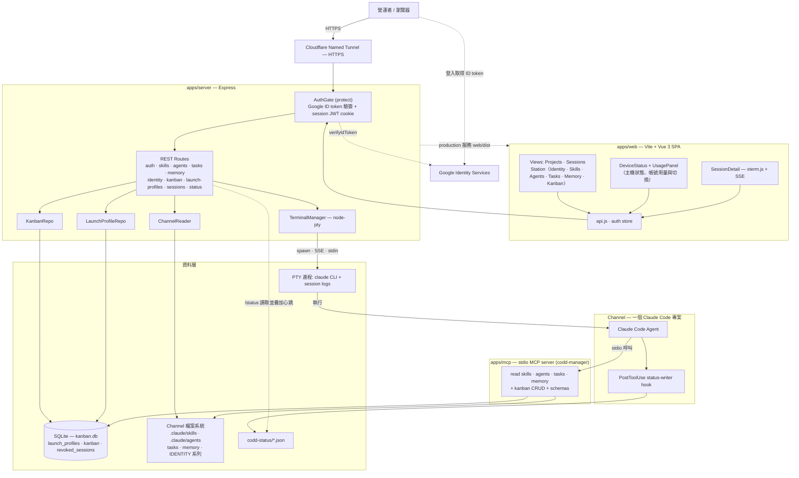
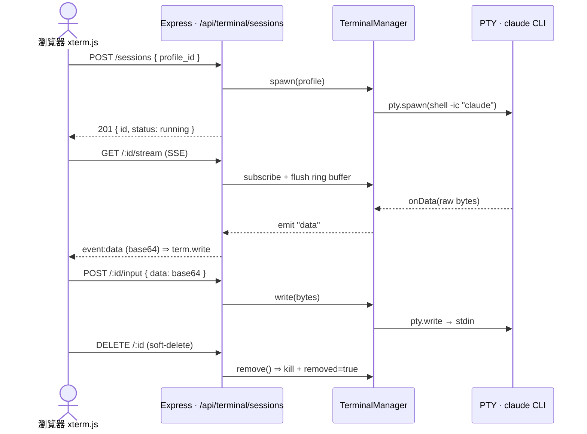

# 🎛️ Fancy CODD — Claude Code Channel Manager

本地端 Express + SQLite + Vite/Vue SPA，**外部用 Cloudflare named tunnel 提供 HTTPS**，**Google Identity Services + ID Token 認證**（無需 client secret），附帶 stdio MCP server 讓 channel 內的 Claude Code agent 自助查詢平台資料。

## 功能

| 模組 | 內容 |
|---|---|
| 🖥️ Sessions | 側欄列出這個 app 開的 Claude Code session（狀態燈、拖曳排序、Alt+1..9），每個 session 可各自設標記色 |
| 📁 Projects | 開 session 的設定（資料夾 + 指令 + env），可設預設標記色，新開的 session 會繼承 |
| 🛰️ Station | 常駐 agent 的基地台：Identity / Skills / Agents / Tasks / Memory / Kanban 合在一頁，用分頁切換 |
| 📊 用量與帳號 | 側欄底部顯示 Claude（cswap）與 Codex 的週用量，可展開看所有帳號並一鍵切換 |
| 📚 Skills | 列出 `$CHANNEL_PATH/.claude/skills/*/SKILL.md`，可線上編輯 frontmatter + body |
| 🤖 Agents | 列出 `.claude/agents/*.md`，可編輯 |
| ⏰ Tasks | 列出 `tasks/*.md`，可編輯 cron / prompt（不重啟 cron） |
| 🧠 Memory | 唯讀，按日期渲染 markdown |
| 📋 Kanban | Ad-hoc Todo 看板，SQLite 儲存，拖拽切換欄位 |
| 🔌 MCP | stdio MCP server，提供 read + Kanban CRUD tools |

## 架構

npm workspaces monorepo（`apps/server` + `apps/web` + `apps/mcp`），對外只開一個 Cloudflare named tunnel，Google ID Token 認證；附一個 stdio MCP server 讓 channel 內的 Claude Code agent 自助查平台資料。下圖為整體元件與資料流：



### 目錄結構

```
2026-remote-claude-code-manager/
├── apps/
│   ├── server/   # Express + better-sqlite3 + Google ID Token verify
│   ├── web/      # Vite + Vue 3 SPA
│   └── mcp/      # @modelcontextprotocol/sdk stdio server
├── configs/
│   ├── hooks/ · statusline/ · agents/   # 注入 Claude Code 的 hook、statusline、sub-agent
│   ├── INSTALL.md
│   ├── cloudflared.yml.example
│   ├── cloudflared-service-setup.md
│   ├── cloudflare-access-setup.md
│   └── google-oauth-setup.md
├── scripts/      # setup-cli.js（hooks + statusline）、channel-cli.js（channel 擴充）
├── docs/
│   └── agent-install.md   # 給 Agent 照做的安裝手冊
├── AGENTS.md · CLAUDE.md
├── .env.example
└── README.md
```

### 即時終端機資料流（PTY ↔ SSE ↔ xterm.js）

Sessions 模組把一個 launch profile 在後端 spawn 成 PTY（跑 `claude`），輸出走 SSE 推到瀏覽器的 xterm.js，鍵盤輸入則走 POST 回寫 PTY stdin；DELETE 為 soft-delete（從預設列表移除，filter 可顯示）。



## 讓 Agent 帶你安裝

先在要常駐跑 CODD 的那台 Mac 上，用「終端機」App 做好這幾步（agent 要在 repo 裡才讀得到安裝手冊）：

1. 安裝 Xcode Command Line Tools（含 git）：`xcode-select --install`，在對話框按「安裝」。
2. 安裝 Claude Code：`curl -fsSL https://claude.ai/install.sh | bash`，開一個新的終端機視窗執行一次 `claude` 登入。
3. clone repo（私有 repo 先設好 GitHub 存取權）。不要放在 `~/Documents`、`~/Desktop`、`~/Downloads` 或 iCloud 底下（macOS 隱私權保護，launchd 跑的 server 讀不到）：

   ```bash
   mkdir -p ~/Github && git clone https://github.com/Wcc723/claude-code-operator-dashboard.git ~/Github/fancy-codd && cd ~/Github/fancy-codd
   ```

4. 在這個資料夾執行 `claude`（或 `codex`），貼上這句：

```text
請讀 docs/agent-install.md，帶我安裝 CODD
```

Agent 會先偵測目前裝到哪一步，只在需要你本人時停下來（填 email 與網域、Google OAuth、Cloudflare、各種登入），其餘自己做並逐步驗證。完整流程見 [docs/agent-install.md](docs/agent-install.md)。

## 安裝

需要 Node.js 20+ 與 macOS / Linux。

```bash
# clone 完進到 root
cp .env.example .env && chmod 600 .env
# 編輯 .env、填入 CHANNEL_PATH / GOOGLE_CLIENT_ID / ALLOWED_EMAIL / SESSION_SECRET
# 所有設定（含前端）都只讀這份根目錄 .env，不需要 apps/web/.env

# 安裝
npm install

# 初始化 SQLite
npm --workspace apps/server run migrate
```

### 生 SESSION_SECRET

```bash
node -e "console.log(require('crypto').randomBytes(32).toString('hex'))"
```

### 設 Google OAuth

照 [configs/google-oauth-setup.md](configs/google-oauth-setup.md) 一步一步做。

## 開發

```bash
npm run dev
# Express  → http://localhost:3000
# Vite     → http://localhost:5173  （前端用這個開）
```

Vite proxy 會把 `/api/*` 轉到 Express。

## 上線

```bash
npm run build     # 把 apps/web 編譯到 apps/web/dist
npm start         # .env 的 NODE_ENV=production 時，Express 同時服務 API 跟靜態檔
npm run tunnel    # cloudflared 起 named tunnel（需先按 configs/cloudflared.yml.example 設定）
```

建議用 launchd / systemd / pm2 讓兩個 process 都自動啟動；macOS 的 launchd 範例見 [docs/agent-install.md](docs/agent-install.md) 步驟 6。

## 帳號用量與切換（Claude / Codex）

側欄底部的 USAGE 區顯示目前 Claude 與 Codex 帳號的**週用量**剩餘（Claude 已取消 5 小時用量，所以只列 1w 與各模型的週額度，例如 Fable；細刻度標出「照進度現在應該剩多少」）。點帳號名稱會展開所有帳號的用量，按「切換」→「確定」即可切換。

| Provider | 資料來源 | 切換方式 |
|---|---|---|
| **Claude** | `cswap`（claude-swap）的 `cswap list --json`（server 快取 20 秒） | `cswap switch <編號>`；切換後新開的 session 用新帳號，執行中的建議重開 |
| **Codex** | `codex app-server` 的 `account/rateLimits/read`（目前帳號 60 秒、其他帳號 10 分鐘探測一次） | 本機帳號庫：把每個帳號的 `auth.json` 存在 `~/.fancy-codd/codex-accounts/`（目錄 0700、檔案 0600），切換時先把目前帳號存回帳號庫、備份原檔，再原子替換 `~/.codex/auth.json` |

- 沒裝 `cswap` 時退回 statusline 回報的目前帳號週用量，並提示安裝；沒裝 Codex CLI 時 CODEX 區塊自動隱藏。
- **加入第二個 Codex 帳號**：先在面板按「加入帳號庫」存下目前帳號，再到主機上執行 `codex login`（沒有瀏覽器就用 `codex login --device-auth`）登入另一個帳號，回到面板按 ↻ 後再按「加入帳號庫」。**不要先跑 `codex logout`**：它會到 OpenAI 撤銷目前的登入，帳號庫裡存的那份也會跟著失效。
- 任何 API 回應、log、錯誤訊息都不含 token；畫面預設只顯示 alias 或遮罩過的 email（完整 email 只在滑鼠提示裡）。
- server 可能由 launchd 啟動、PATH 不完整，所以會依序找 `CSWAP_BIN` / `CODEX_BIN` → PATH → `~/.local/bin` → `/opt/homebrew/bin` → `/usr/local/bin`（Codex 另找 Codex.app / ChatGPT.app 內附的 CLI）。其他選填環境變數見 `.env.example`（`CODEX_HOME`、`CODD_CODEX_VAULT`）。

## 接上 Claude Code 狀態（hooks + statusline）

側欄的 session 狀態（忙碌 / 等你輸入 / 閒置）、Claude 標題、最近一次 prompt，以及沒有 cswap 時底部的週用量，都來自 Claude Code 自己回報的資料。要拿到這些資料，得在 **跑 server 的那台機器（Mac mini）** 的 user-level `~/.claude/settings.json` 裝上 CODD 的 hooks 與 statusline。第一次打開網頁時首頁會引導你到 `/setup`（勾選 → 預覽 → 一鍵安裝），也可以用 CLI：

```bash
npm run setup -- status                # 看目前狀態（不寫檔）
npm run setup -- install --dry-run     # 預覽會改什麼
npm run setup -- install               # 安裝（已裝好就不動）
npm run setup -- uninstall             # 移除 hooks，statusline 還原成原本的
```

| 部分 | 裝了什麼 | 用途 |
|---|---|---|
| **hooks** | `SessionStart` / `UserPromptSubmit` / `PreToolUse` / `PostToolUse` / `PostToolUseFailure` / `PermissionRequest` / `Notification` / `Stop` / `StopFailure` / `SessionEnd` 各加一組 `configs/hooks/status-writer.js` | session 狀態（busy / 等待輸入 / idle）、自訂標題、最近 prompt |
| **statusline** | `statusLine.command` 換成 `configs/statusline/codd-statusline.js` | Claude 標題、context 剩餘、目前帳號的週用量 |
| **legacy** | 移除 `CHANNEL_PATH/.claude/settings.json` 裡舊的 channel 級 PostToolUse hook | 避免和新的 hook 重複觸發 |

重點：

- **只動 `hooks` 與 `statusLine` 兩塊**，其他設定（`env`、`permissions`、你原本的 hooks…）原封不動；每次寫入前都會在旁邊留一份 `settings.json.codd-bak-<時間>` 備份。
- **不是這個 app 開的 session 幾乎零成本**：hook 指令開頭是 `[ -z "$CODD_TERMINAL_ID" ] || …`，沒有這個環境變數就直接結束，連 node 都不會啟動。
- **保留你現有的 statusline**（例如 RayAgentHub）：CODD 會把原指令以 base64 串在 `--chain-b64` 後面，畫面照舊顯示原本那支，CODD 只是順手記錄標題與用量；`uninstall` 會原樣還原。
- 指令裡寫的是當下 node 與 repo 的絕對路徑；換了 node 版本或搬了 repo，`status` 會顯示 `outdated`（或 node 已不存在的警告），再跑一次 `install` 即可。在那之前原本的 statusline 照常顯示，hooks 安靜跳過。
- 細節與手動還原方式見 [configs/INSTALL.md](configs/INSTALL.md#user-level-設定session-狀態與用量npm-run-setup)。

## 接 MCP 進你的 channel

在你的 channel `.mcp.json` 加：

```json
{
  "mcpServers": {
    "codd-manager": {
      "command": "node",
      "args": ["/abs/path/to/2026-remote-claude-code-manager/apps/mcp/src/index.js"],
      "env": {
        "CHANNEL_PATH": "/abs/path/to/2026-local-AI-Agent",
        "KANBAN_DB_PATH": "/abs/path/to/2026-remote-claude-code-manager/apps/server/data/kanban.db"
      }
    }
  }
}
```

Claude Code session 啟動後，agent 會自動看到 `mcp__codd-manager__list_skills` 等 tools。

### MCP tools 清單

| Tool | 用途 |
|---|---|
| `list_skills` / `get_skill` | 讀 skills |
| `list_agents` / `get_agent` | 讀 agents |
| `list_tasks` / `get_task` | 讀 tasks |
| `list_memory_days` / `get_memory_day` | 讀 memory |
| `kanban_list_cards` / `kanban_get_card` | 查 Kanban |
| `kanban_create_card` / `kanban_update_card` / `kanban_delete_card` | 改 Kanban |

**MCP 預設不能直接改 skills / agents / tasks 檔案** — 這些只能透過 Web UI 編輯，避免 agent 誤改重要設定。

## 擴充 Channel（hooks / sub-agents）

Fancy CODD 提供三個可注入 channel 的擴充：

| 模組 | 內容 |
|---|---|
| **PostToolUse hook**（舊版） | 已由上面的 `npm run setup` 取代，`install` / `update` 預設跳過；`npm run setup -- install` 會移除舊的那條 |
| **frontmatter-doctor sub-agent** | 對 channel 內 agents / skills 的 frontmatter 體檢，產 audit 報告 |
| **codd-manager MCP** | 把 MCP server 掛進 channel `.mcp.json`，agent 可呼叫 kanban / schema tools |

三個模組透過一個 CLI 管整套生命週期：

```bash
npm run channel status      # 看現況
npm run channel install     # 安裝（已存在則 skip）
npm run channel update      # 升級
npm run channel uninstall   # 卸載（軟卸載；--purge 連檔案刪）

# 共通 flags（要放在 -- 後面，例如 npm run channel -- install --dry-run）
--dry-run            # 只印 diff 不寫
--only agents,mcp    # 只動指定部分
--channel <path>     # 覆蓋 .env 的 CHANNEL_PATH
```

flag 一定要寫在 `--` 後面：`npm run channel install --dry-run` 的 `--dry-run` 會被 npm 吃掉，結果是**真的安裝**。

完整指引：[configs/INSTALL.md](configs/INSTALL.md)

## 驗證

安裝完成後的驗收清單見 [docs/agent-install.md](docs/agent-install.md) 步驟 12。

## 安全模型

- Google Identity Services 用 ID token（JWT signed by Google）
- 後端 `verifyIdToken({ audience: GOOGLE_CLIENT_ID })` 驗簽 + 防 replay
- `email === ALLOWED_EMAIL` 且 `email_verified === true` 才放行
- 自家 session JWT 透過 **HTTP-only + Secure + SameSite=Strict cookie** 派發
- CSP header 限制 script-src 只能來自 self、`accounts.google.com` 與 Cloudflare 強制注入的 `static.cloudflareinsights.com`
- 寫入 API 一律 POST/PATCH/DELETE
- 詳見 [configs/google-oauth-setup.md](configs/google-oauth-setup.md)

## License

Private / MIT for personal use.
